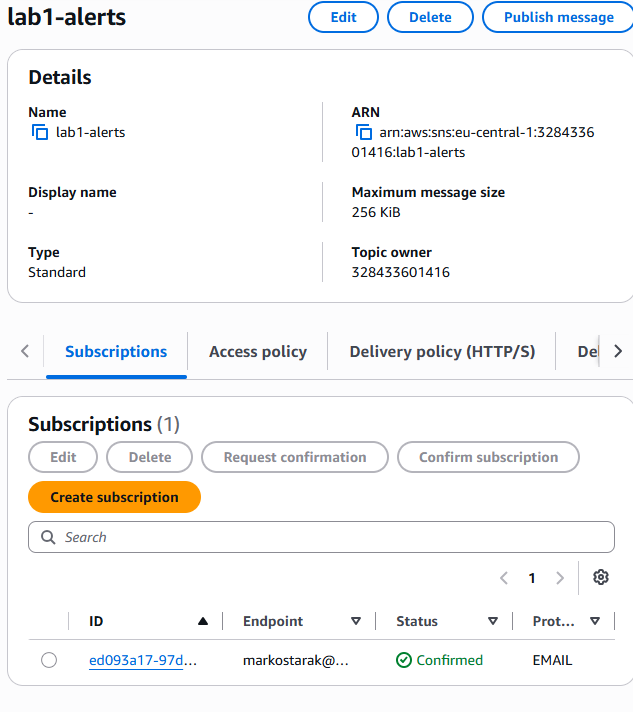
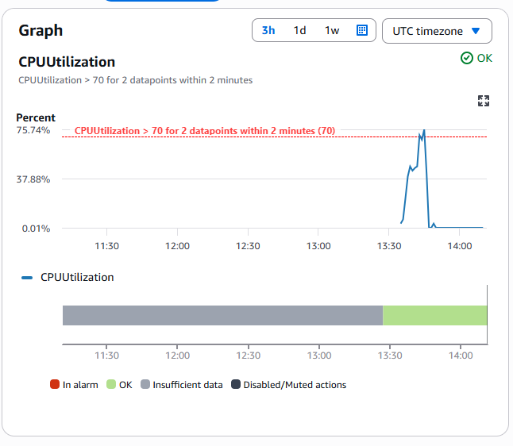
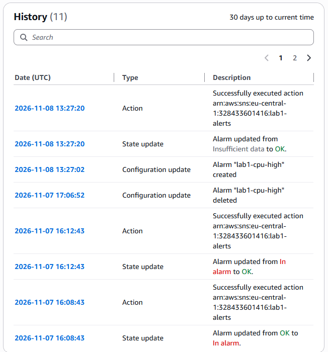
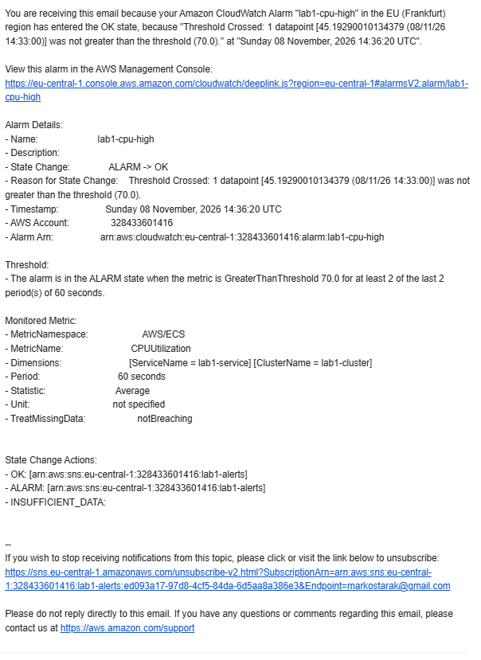
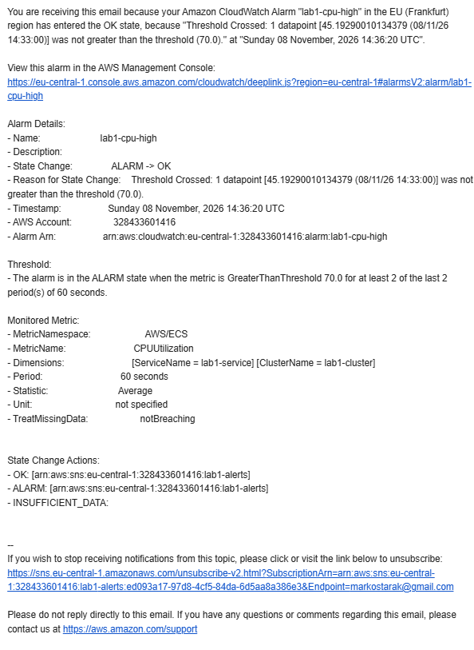

# Налаштування сповіщень (CloudWatch + SNS)

## 1. Умова сповіщення та обґрунтування

У `terraform/monitoring.tf` налаштовано CloudWatch Alarm `lab1-cpu-high`:

- **Метрика**: `CPUUtilization` (AWS/ECS)
- **Умова**: CPU > 70%
- **Період оцінки**: 2 періоди по 60 секунд (2 хвилини поспіль)
- **Канал доставки**: тема SNS `lab1-alerts` із підпискою на Email

### Чому обрано такі параметри?
1. **Поріг 70% CPU**: автоскейлінг починає додавати таски вже при 60%. Якщо навантаження перевалило за 70% — значить новий таск ще не піднявся або сервіс вперся в ліміт тасків (`max=4`). При цьому до критичних 100% ще залишається запас у 30%, щоб встигнути відреагувати без падіння сервісу.
2. **2 періоди по 60 секунд (2 хвилини)**: захист від хибних спрацювань. Короткочасний хвилинний сплеск CPU не є аварією. Вимога 2 хвилин поспіль відсікає шум і запобігає спаму на пошту (flapping).

---

## 2. Знімки сповіщень

Під час навантажувального тесту надійшли обидва листи — про вхід у стан тривоги та про повернення до норми.

*Рис. 1. Графік CloudWatch: перевищення порогу 70% і повернення в норму.*

*Рис. 2. Історія подій алерту: зміна станів `OK -> IN ALARM` та `IN ALARM -> OK`.*

### Лист про тривогу (`ALARM`)
Коли CPU перевищив 70% протягом двох хвилин (пік сягнув 75.74%), CloudWatch надіслав сповіщення:

### Лист про повернення в норму (`OK`)
Після підняття другого таску і завершення тесту CPU впав нижче 70% (зафіксовано 45.19%), і надійшов лист про нормалізацію:

---

## 3. Час реакції системи

- **Час від початку сталого навантаження до першого листа**: склав близько **2.5–3 хвилин** (1 хвилина на ріст навантаження до 70% + 2 хвилини очікування правила CloudWatch `evaluation_periods = 2` + декілька секунд на доставку листа SNS).

### Чи прийнятний такий час реакції для реального сервісу?
- **Для завантаження CPU — так, цілком прийнятний**. CPU не руйнує систему за секунди. Затримка у 2–3 хвилини дає автоскейлінгу шанс самостійно підняти контейнер і погасити хвилю без виклику чергового інженера серед ночі.
- Якщо ж мова йде про падіння доступності чи ріст помилок (HTTP 5xx) — там ставиться вікно 1 хвилина, оскільки падіння сервісу вимагає негайної реакції.
