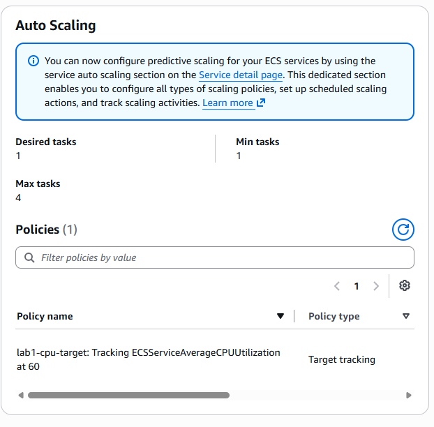
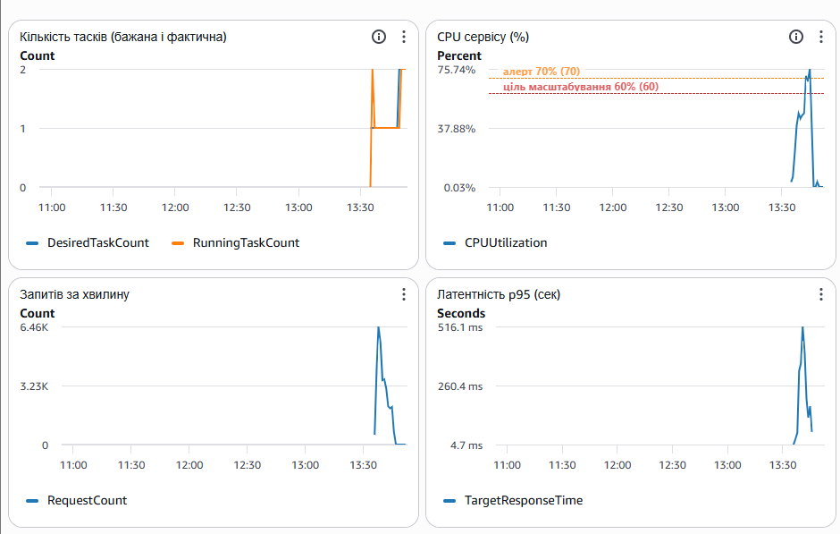

# Автоматичне масштабування та моніторинг

## 1. Параметри масштабування

У `terraform/autoscaling.tf` налаштовано політику `TargetTrackingScaling` для ECS-сервісу:

- **Мінімум екземплярів**: 1
- **Максимум екземплярів**: 4
- **Метрика**: `ECSServiceAverageCPUUtilization`
- **Цільове значення**: 60%
- **Scale-out cooldown**: 60 секунд
- **Scale-in cooldown**: 300 секунд (5 хвилин)

### Обґрунтування цільового значення 60%

- Якби поріг стояв 80–90%, то за час запуску нового таску наявний контейнер досяг би 100% CPU і запити почали б відпадати за таймаутом (504 Gateway Timeout). 40% запасу дають системі час підняти репліку без збоїв.
- Встановлювати менше (наприклад 30–40%) невигідно, бо контейнери масштабувалися б навіть на коротких дрібних сплесках, марнуючи гроші.

---

## 2. Період стабілізації (Cooldown)

**Cooldown** — це пауза після операції масштабування, під час якої система ігнорує нові сигнали на додавання або видалення екземплярів, даючи їм час стабілізуватися:
- **Scale-out (60 с)**: дає новому таску запуститися і взяти трафік, перш ніж вирішувати, чи потрібен ще один.
- **Scale-in (300 с)**: запобігає передчасному вбивству екземпляра, якщо навантаження впало ненадовго.

### Що станеться, якщо встановити cooldown = 0?
Виникне явище **flapping**:
На будь-якому короткому коливанні трафіку сервіс буде постійно то створювати, то одразу вбивати контейнери. Нові таски не встигатимуть прогрітися, старі обриватимуть активні з'єднання клієнтів, а база даних отримає зайвий стрес від постійних перепідключень.

---

## 3. Знімки панелі моніторингу та хронологія

Під час 10-хвилинного тесту (k6 на 30 користувачів) поведінка системи відображалася на дашборді CloudWatch:

### Позначені моменти тесту:
1. **13:30 (Початок навантаження)** — k6 починає нарощувати користувачів, графік запитів за хвилину стрімко зростає до 6.46K.
2. **13:33 (Перетин порогу процесора)** — CPU перевищує ціль у 60% і алерт у 70%, сягаючи піку **75.74%**. Латентність p95 підскакує до 516 мс.
3. **13:35 (Поява нового екземпляра)** — після запуску і проходження health check `RunningTaskCount` зростає з 1 до 2. Трафік ділиться між двома тасками, завантаження CPU різко спадає.
4. **13:40 (Спад навантаження)** — тест завершується, кількість запитів падає до нуля.
5. **13:46 (Вилучення екземпляра)** — після закінчення 5-хвилинного cooldown `DesiredTaskCount` та `RunningTaskCount` повертаються до 1.

---

