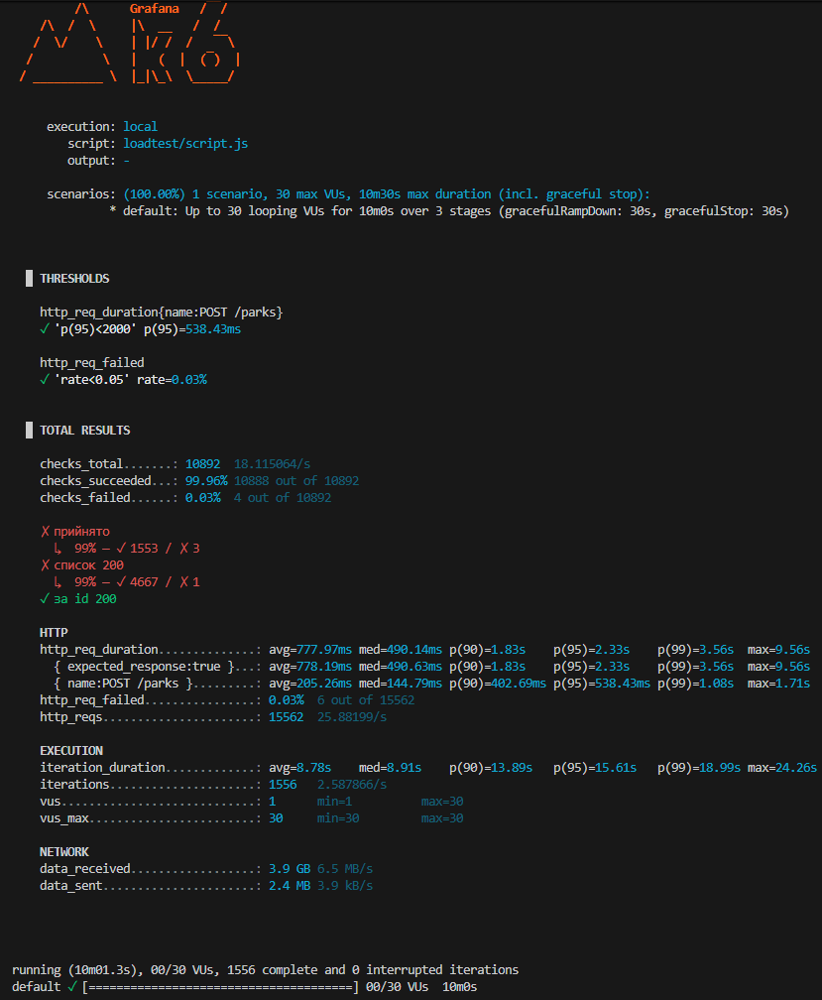
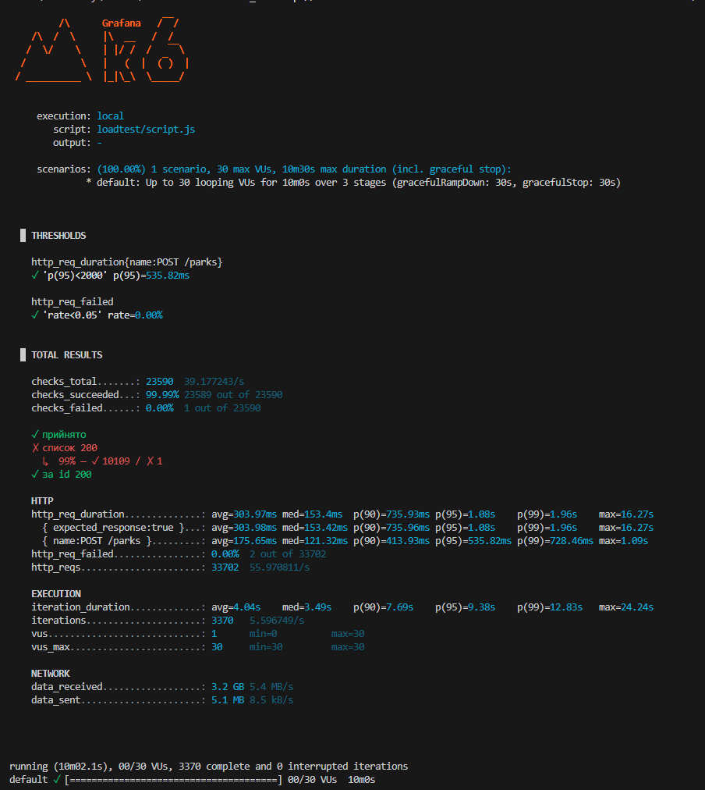
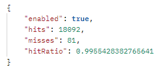
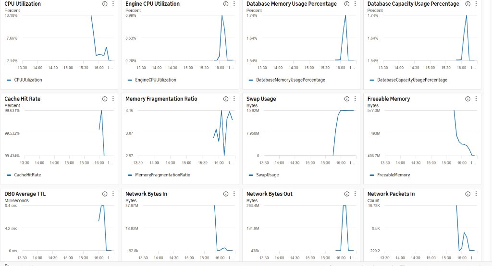

# Кешування операцій читання (Redis Cache-Aside)

## 1. Схема роботи (Cache-Aside)

Для операції читання списку парків (`GET /parks`) у `app/server.js` реалізовано патерн **Cache-Aside** через Redis:

1. Запит перевіряє наявність ключа `parks:list:...` у Redis.
2. Якщо ключ є (**Cache Hit**) — результат віддається одразу з пам'яті за 2–5 мс.
3. Якщо ключа немає (**Cache Miss**) — виконується SQL-запит до MySQL, результат записується в Redis з `TTL = 30` секунд і повертається клієнту.

---

## 2. Порівняння результатів: «Без кешу» проти «З кешем»

Сценарій k6 (30 користувачів, 10 хвилин) було прогнано з вимкненим та увімкненим кешем:

| Показник | Без кешу (Direct MySQL) | З кешем (Redis) | Різниця |
| :--- | :---: | :---: | :---: |
| **Латентність `p95`** | **2,330 ms (2.33 s)** | **1,080 ms (1.08 s)** | Швидше більш ніж удвічі |
| **Латентність медіана (`p50`)** | 490.14 ms | **153.40 ms** | Швидше в 3.2 раза |
| **Кількість запитів за секунду** | 25.88 req/s | **55.97 req/s** | Пропускна здатність вища в 2.16 раза |
| **Всього виконано запитів** | 15,562 | **33,702** | +18,140 запитів за ті самі 10 хв |
| **Помилки (`http_req_failed`)** | 0.03% (6 збоїв) | **0.00%** (0 збоїв) | Повна відсутність збоїв |
| **Навантаження на базу даних** | 100% запитів читання йдуть у диск і пул MySQL | Лише поодинокі запити раз на 30 с; база вільна | Зниження навантаження на базу на ~95% |

*Рис. 1. k6 без кешу.*

*Рис. 2. k6 з Redis.*

---

## 3. Частка влучань у кеш (Cache Hit Ratio)

Частка влучань розраховується за стандартною формулою:

$$\text{Cache Hit Ratio} = \frac{\text{Hits}}{\text{Hits} + \text{Misses}} \times 100\%$$

Під час прогону навантажувального тесту стан лічильників кешу зафіксував такі показники:

- **Влучань (`hits`)**: 18,092
- **Промахів (`misses`)**: 81
- **Фактична частка влучань (`hitRatio`)**: **0.9955 (99.55%)**

$$\text{Hit Ratio} = \frac{18,092}{18,092 + 81} = \frac{18,092}{18,173} \approx \mathbf{99.55\%}$$

*Рис. 3. Дані лічильників влучань та промахів кешу.*

Також ці дані повністю підтверджуються графіками панелі моніторингу **AWS ElastiCache (Redis)** у CloudWatch:

*Рис. 4. Графіки CloudWatch для Redis: пік метрики Cache Hit Rate сягає 99.631%.*

### Ключові висновки за графіками ElastiCache:
1. **Cache Hit Rate**: стабільно тримається на рівні **99.43% – 99.63%**, що підтверджує, що майже всі повторні читання списків парків обслуговуються з пам'яті.
2. **Engine CPU Utilization**: пік усього **0.99%** (менше 1%), а Database Memory Usage — **1.74%**. Redis легко витримує великий потік читань без навантаження на ресурси.
3. **Network Bytes Out**: пік **263.4 MB**, що відображає активну роздачу закешованих JSON-відповідей без звернень до MySQL.

---

## 4. Актуальність даних після запису

### Скільки часу клієнт може бачити застарілі дані?
- До закінчення терміну дії ключа — тобто **до 30 секунд** (час життя `TTL`). Протягом цього часу новий парк уже є в базі, але список повертає закешований зріз.

### Як зменшити або прибрати цей час?
1. **Активна інвалідація (Cache Eviction)**: при додаванні нового парку через `POST /parks` (або у воркері після запису в базу) видаляти ключі списків: `await redis.del('parks:list:*')`. Тоді клієнт побачить новий парк за мілісекунди.
2. **Скорочення TTL**: встановити 5–10 секунд замість 30, але це збільшить кількість звернень до бази.
3. **ETag / conditional requests**: віддавати клієнту хеш версії даних.

