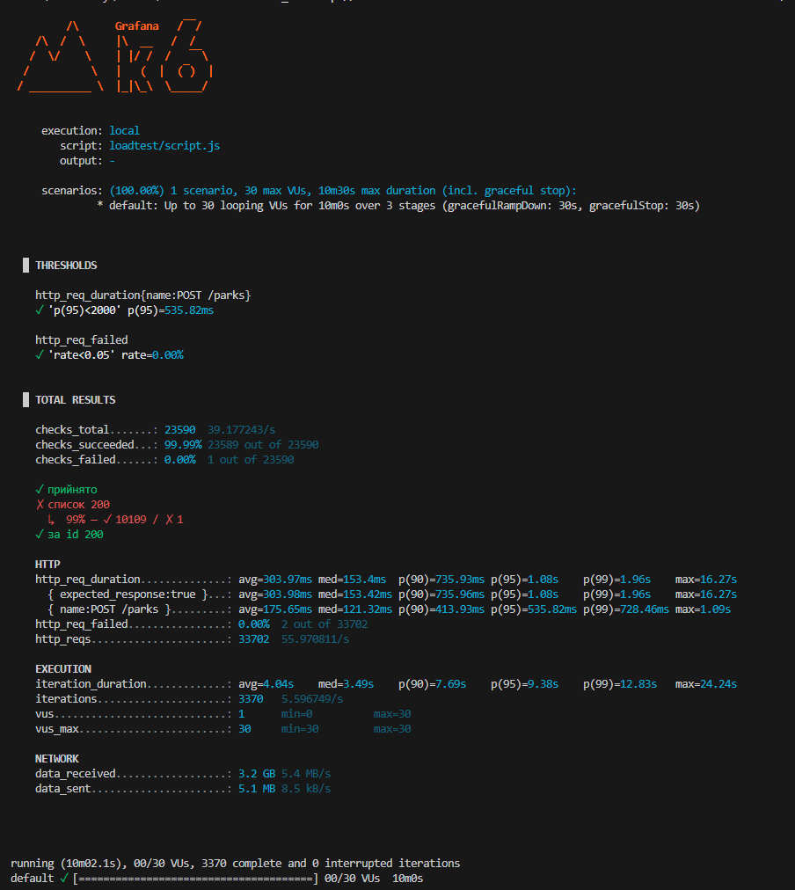
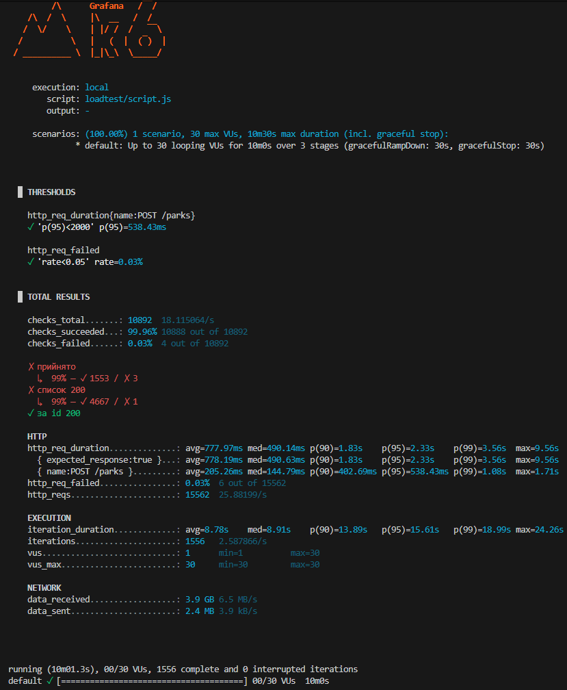

# Сценарій навантажувального тестування

## 1. Команда запуску

Тестування запускається через k6 з передачею URL балансувальника:

```bash
k6 run -e BASE_URL="http://lab1-alb-2027386291.eu-central-1.elb.amazonaws.com" -e VUS=30 loadtest/script.js
```

## 2. Параметри та логіка сценарію

Сценарій імітує поведінку користувачів «мало записів, багато читань»:
- **1 запис**: `POST /parks`. Сервіс відповідає `202 Accepted` і повертає `jobId`, після чого тест опитує `GET /jobs/:jobId`, поки парк не створиться воркером.
- **9–10 читань**: 3 запити списку `GET /parks`, 3 запити конкретного парку `GET /parks/:id`, 2 пошуки `GET /parks?search=...`, 1 сортування `GET /parks?sortBy=...`.
- **Фази тесту (разом 10 хвилин)**:
  - `3m` — наростання від 0 до 30 VUs;
  - `5m` — стале навантаження 30 VUs (на цьому етапі спрацьовує масштабування);
  - `2m` — спад навантаження до 0.

---

## 3. Підсумковий звіт

Тест проведено з увімкненим кешуванням Redis (основний) та для порівняння — без кешу.


*Рис. 1. Результати тесту з кешем.*


*Рис. 2. Результати тесту без кешу.*

### Порівняльна таблиця метрик

| Метрика | З кешем (Redis) | Без кешу | Різниця |
| :--- | :---: | :---: | :---: |
| **Кількість запитів (`http_reqs`)** | **33,702** | 15,562 | +116% (у 2.16 раза більше) |
| **Пропускна здатність** | **55.97 req/s** | 25.88 req/s | +116% |
| **Частка помилок (`http_req_failed`)** | **0.00%** (2 з 33.7K) | 0.03% (6 з 15.5K) | Помилок майже немає |
| **Латентність середній час (`avg`)** | **303.97 ms** | 777.97 ms | Швидше в 2.5 раза |
| **Латентність медіана (`p50`)** | **153.40 ms** | 490.14 ms | Швидше в 3.2 раза |
| **Латентність `p95`** | **1,080 ms (1.08 s)** | 2,330 ms (2.33 s) | Знизилась більш ніж удвічі |
| **Латентність `p99`** | **1,960 ms (1.96 s)** | 3,560 ms (3.56 s) | Знизилась на 45% |
| **Латентність `POST /parks` (`p95`)** | **535.82 ms** | 538.43 ms | Стабільна завдяки SQS |
| **Частка влучань у кеш (`hitRatio`)** | **99.55%** (18,092 hits / 81 misses) | — | Детальніше у [CACHE.md](CACHE.md) |
