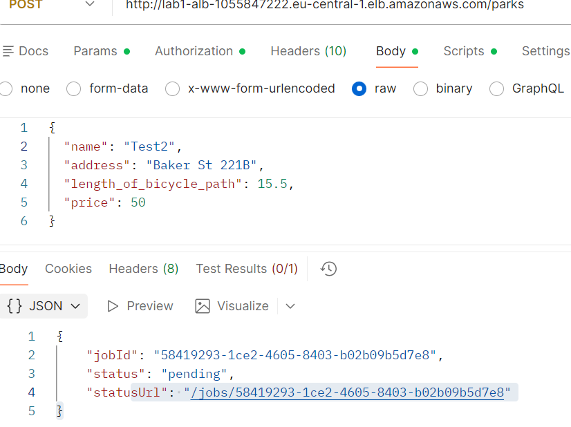
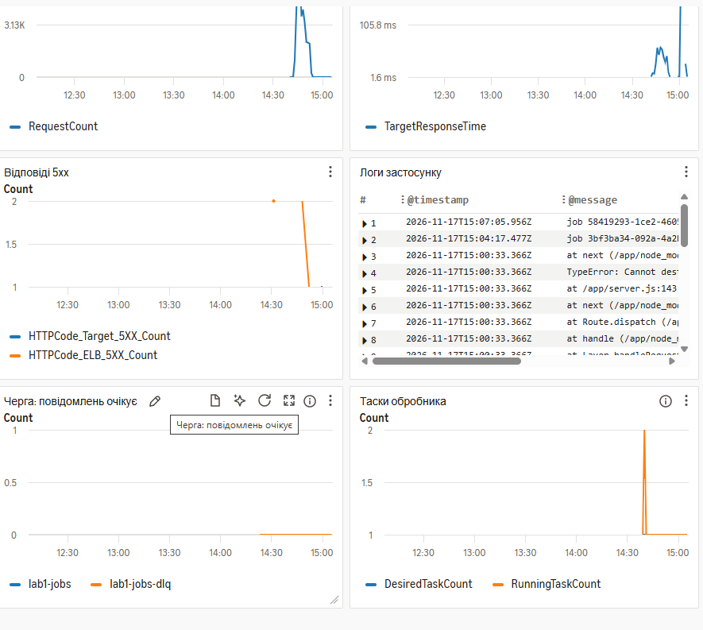

# Асинхронна обробка через чергу (Amazon SQS + Worker)

## 1. Як це працює

Операцію створення парку `POST /parks` винесено в асинхронну чергу Amazon SQS (`terraform/queue.tf`):

1. API приймає запит, кидає повідомлення в чергу SQS `lab1-jobs`, ставить у Redis статус `pending` і одразу повертає клієнту статус `202 Accepted` та `{ "jobId": "..." }`.
2. Окремий фоновий мікросервіс `lab1-worker` (`app/worker.js`) вичитує SQS, робить `INSERT` у MySQL, оновлює статус у Redis на `done` (`parkId`) і видаляє повідомлення з черги.

---

## 2. Що змінилося для клієнта і як дізнатися результат?

- **Що змінилося**: замість коду `201 Created` клієнт миттєво отримує `202 Accepted`. Латентність запиту тепер не залежить від швидкості запису на диск у MySQL і становить усього ~100–180 мс.
- **Як клієнт дізнається результат**: 
  - Через опитування (polling): клієнт робить періодичні запити `GET /jobs/:jobId` (у тесті k6 — раз на 500 мс). Оскільки статус перевіряється в таблиці `processed_jobs`, це займає лічені мілісекунди і не створює навантаження на систему.
  - У продакшні альтернативою можуть бути Webhooks або WebSocket / SSE.

---

### Підтвердження роботи черги

1. **Клієнтський запит (`POST /parks`)**: клієнт отримує статус `202 Accepted` із унікальним `jobId`:

*Рис. 1. Успішне прийняття завдання в чергу з поверненням jobId (`58419293-1ce2-4605-8403-b02b09b5d7e8`).*

2. **Обробка воркером та метрики CloudWatch**:

*Рис. 2. Панель CloudWatch: у блоці «Логи застосунку» зафіксовано виконання завдання воркером (`job 58419293-1ce2... done`), а графік масштабування відображає роботу фонових тасків.*

## 3. Доставка «щонайменше один раз» (At-Least-Once Delivery)

- **Що це означає**: SQS гарантує, що повідомлення ніколи не загубиться, але через можливі мережеві збої чи закінчення Visibility Timeout одне й те саме повідомлення може бути доставлене воркеру більше одного разу.
- **Що буде при повторній обробці**:
  - Якщо в коді немає захисту, в базі з'явиться дублікат парку.
  - У нашому рішенні перед записом перевіряється унікальний `jobId` або стан у Redis: якщо завдання вже має статус `done`, воркер просто видаляє повідомлення з SQS, не виконуючи повторний запис у MySQL.
- **Dead-Letter Queue (DLQ)**: якщо повідомлення з якихось причин впало 5 разів поспіль (`maxReceiveCount = 5`), воно відправляється в чергу `lab1-jobs-dlq`, щоб не блокувати роботу інших завдань.
